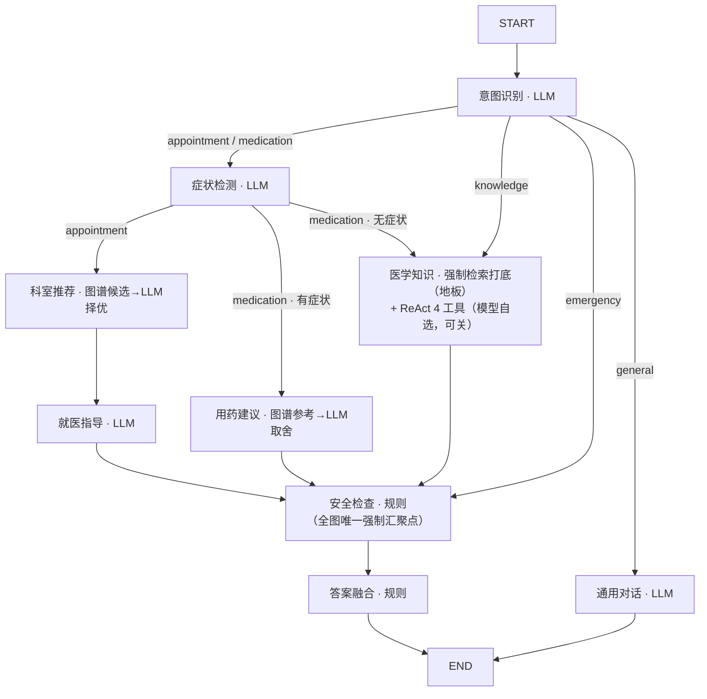

# 智慧问诊Agent系统（SmartMedicalConsultation）

基于**医疗知识图谱（Neo4j）+ 向量检索（FAISS / BGE-M3）+ LangGraph 多 Agent**的医疗问诊问答系统。后端 FastAPI 同时托管 API 与 Vue 前端静态文件，**单进程部署**；外部中间件为 **Neo4j（图谱）+ Redis（会话热缓存 / L1 答案缓存）+ MySQL 8.0（对话历史冷存储）**三件套，由 `docker-compose.yml` 一键拉起。只起 Neo4j 也能跑问答，但多轮记忆与答案缓存会一路降级告警。

> ⚠️ 医疗免责声明：本系统所有回答仅供健康科普与就医导诊参考，**不能替代专业医疗诊断与治疗**。急症请立即就医或拨打 120。

---

## 功能特性

- **意图路由多 Agent**：`intent_classifier` 将问题分流到挂号 / 用药 / 医学知识 / 急症 / 通用五条链路，LangGraph `StateGraph` 编排。
- **知识溯源问答**：医学知识分支先**强制检索** KG + FAISS（grounding 底线），再可选启用 ReAct 多跳工具层；高风险问题检索落空时**不猜测**、直接建议就医。
- **三层科室推荐**：KG 候选 → LLM 择优过滤 → 兜底追问，过滤与症状无关的噪声科室。
- **用药安全红线**：只给出与症状相称的常规/OTC 药物，主动拒绝 KG 中的无关高危药物（如化疗药）。
- **确定性安全层**：急症识别（LLM 意图 + 高精度关键词兜底）、强制免责声明、急症置顶警告。
- **多轮会话记忆**：Redis 热缓存（最近 12 轮 + TTL 24h）+ MySQL 冷存储（全量历史、唯一事实源），双写先 MySQL 后 Redis（缓存可缺不可幻）；按 token 预算滑窗并在窗口外做增量摘要。
- **执行态可中断（checkpointer）**：LangGraph 挂 SqliteSaver，`AgentState` 按 `thread_id=user_{uid}__session_{sid}` 落盘——可回读、可回溯、按用户隔离；采用「一轮一线程 + 轮首清空」（`operator.add` 字段不清会翻倍）。它是 HITL 人工审核闸门的硬前置（契约见 `TDD.md` §13）。
- **可量化评测门禁**：53 条金标集 + RAGAS/LLM 裁判，硬规则不达标即非零退出（可进 CI）。

## 技术栈

| 层          | 技术                                                                   |
| ----------- | ---------------------------------------------------------------------- |
| LLM         | 阿里百炼 DashScope（OpenAI 兼容接口）；具体模型由 `.env` 的 `MODEL_NAME` 决定（模板默认 `qwen-plus`，代码兜底默认见 `config/settings.py`） |
| Agent 编排  | LangChain 1.x · LangGraph · SqliteSaver checkpointer（执行态持久化） |
| 知识图谱    | Neo4j 5.26                                                             |
| 向量检索    | FAISS · BGE-M3（本地）                                                |
| 后端        | FastAPI · Uvicorn · Pydantic v2                                      |
| 中间件      | Redis（会话热缓存 / L1 答案缓存，AOF 持久化）· MySQL 8.0（对话历史冷存储）——与 Neo4j 一起由 docker-compose 编排 |
| 用户认证    | PyJWT（HS256）· bcrypt 密码哈希 · 会话/缓存按用户隔离             |
| 前端        | Vue 3 · Element Plus · Vite（构建后由 FastAPI 托管）                 |
| 语言/运行时 | Python 3.11+ · Node.js 18+                                            |

## 项目结构

```
├── config/            # settings.py(.env) / paths.py 路径与配置
├── crawler/           # 离线：疾病数据爬取与清洗
├── scripts/           # 离线流水线 + start_api.py 一键启动
├── src/
│   ├── extraction/    # LLM 实体/关系抽取
│   ├── knowledge_graph/ # 图谱构建、查询、校验
│   ├── vector_store/  # FAISS 向量检索
│   ├── agents/        # 9 个 Agent + graph.py 编排 + state.py 状态 + checkpointer.py 执行态持久化
│   ├── common/        # llm / logger / utils / tokens / memory / observe / answer_cache
│   ├── history/       # store.py 对话历史冷热分层 + summarizer.py 增量摘要
│   ├── auth/          # security.py（JWT/bcrypt）+ deps.py（三道归属防线）+ store.py
│   └── api/           # FastAPI 应用与路由（routes.py 问诊 / auth_routes.py 认证）
├── evals/             # 数据集 + 评测 runner/judge + 报告
├── models/bge-m3/     # 本地嵌入模型
├── frontend/          # Vue 3 前端源码
└── docker-compose.yml # Neo4j + Redis + MySQL 三件套
```

**问答流程（意图路由 DAG）：**



## 快速开始

### 1. 启动中间件（Neo4j / Redis / MySQL）

```bash
docker-compose up -d          # Neo4j Web UI http://localhost:7474 (neo4j / 12345678)
docker-compose ps             # 三个服务都应为 Up
```

### 2. 配置环境

```bash
python -m venv .venv && .venv\Scripts\activate   # Windows；Linux/macOS 用 source .venv/bin/activate
pip install -r requirements.txt
python validate_env.py        # 校验环境配置
```

复制模板创建 `.env`（模板入库、`.env` 已在 `.gitignore` 中，永不提交）：

```bash
copy .env.example .env    # Windows；Linux/macOS 用 cp .env.example .env
```

然后编辑 `.env` 填入真实值（至少填 `MODEL_API_KEY`，[在此申请](https://dashscope.console.aliyun.com/apiKey)；
全部字段与可选调优项见 `.env.example` 内注释）：

```dotenv
MODEL_API_KEY=sk-xxxxxxxx          # 必填：DashScope API Key
MODEL_BASE_URL=https://dashscope.aliyuncs.com/compatible-mode/v1
MODEL_NAME=qwen-plus             # 本仓库当前 .env 实测跑的是 qwen3.7-flash；按账号可用性选
EMBEDDING_MODEL_PATH=./models/bge-m3   # 本地 BGE-M3 目录（仓库已自带）
LOG_LEVEL=INFO
```

### 3. 构建知识库（离线流水线）

仓库已附带抽取好的中间数据（`data/`），如需重建：

```bash
python scripts/run_extraction.py        # LLM 抽取实体/关系 → data/knowledge_graph/*.json
python -m src.knowledge_graph.graph_builder   # 导入 Neo4j
python scripts/build_index.py           # BGE-M3 向量化 → data/indexes/ (FAISS)
```

### 4. 启动应用

```bash
python scripts/start_api.py             # 首次自动构建前端 (npm run build)
```

| 入口         | 地址                              |
| ------------ | --------------------------------- |
| 聊天界面     | http://localhost:8000/            |
| Swagger 文档 | http://localhost:8000/docs        |
| 问诊接口     | http://localhost:8000/api/consult |

前端独立开发（热重载）：`cd frontend && npm install && npm run dev`

## API

以下端点均挂在 `/api` 前缀下；标 🔒 的需带 `Authorization: Bearer <token>`（缺失/无效 → 401）。

| 方法   | 路径                                     | 说明                                                                                                              |
| ------ | ---------------------------------------- | ----------------------------------------------------------------------------------------------------------------- |
| POST   | `/api/auth/register`                   | 注册（bcrypt 哈希；重名 409）                                                                                     |
| POST   | `/api/auth/login`                      | 登录（OAuth2 表单 `username` / `password`）→ 返回 JWT                                                            |
| GET    | `/api/auth/me`                         | 🔒 当前用户信息                                                                                                  |
| POST   | `/api/consult`                         | 🔒 问诊（60s 超时、5 并发上限）；返回 `answer / intent / symptoms / departments / medications / disclaimers / warnings / linked_entities / duration_ms / cached` |
| POST   | `/api/consult/stream`                  | 🔒 SSE 流式问诊：`progress`（逐节点）→ `answer`（完整响应）→ `done`；异常 `error`                         |
| GET    | `/api/conversations`                   | 🔒 会话历史列表（仅本人）                                                                                         |
| GET    | `/api/conversations/{id}`              | 🔒 恢复单个会话；非属主 → 404（不泄露存在性）                                                                     |
| DELETE | `/api/conversations/{id}`              | 🔒 删除会话                                                                                                       |
| GET    | `/api/health`                          | 健康检查（Neo4j / 向量索引 / Agent 系统状态）                                                                     |
| GET    | `/api/stats`                           | 知识图谱 / 向量索引 / API 统计                                                                                    |

完整字段定义以 `src/api/models.py` 为准（R3 前后端字段契约的单一事实来源）。

## 评测

```bash
make eval-fast    # PR 用：smoke 子集（快、便宜）
make eval-full    # 全量 53 条金标集
make eval-e2e     # 经已启动的 API 做端到端（先启动 start_api.py）
```

报告写入 `evals/last_report.md`。**硬规则门禁**：免责声明覆盖率 < 100% / 急症召回 < 阈值 / 意图准确率 < 阈值 → 退出码非 0。`evals/ci_github_actions.yml` 为 GitHub Actions 参考模板。

**执行态持久化自检**（零 LLM、零中间件，无需 API Key）：

```bash
python src/agents/checkpointer.py    # 契约/落盘/累加事故复现/单例，失败退出码非 0
python src/agents/graph.py           # 真实图挂载与回读断言（需 MODEL_API_KEY + Neo4j）
```

## 本地 CI 门禁（pre-push）

TDD 第 0 章 R7 管"AI 生成模块后立即自检"；`.githooks/pre-push` 管最后一道：**任何人 push 前自动跑契约验收（R1/R3/R4/R5），不绿则阻止推送**。

```bash
# clone 后执行一次即可启用（core.hooksPath 不随仓库传播）
git config core.hooksPath .githooks

# 可选：push 时追加评估 smoke 子集（需 MODEL_API_KEY，耗 token）
# Windows PowerShell:  $env:PUSH_EVAL="1"; git push
PUSH_EVAL=1 git push

# 紧急绕过（不推荐）
git push --no-verify
```

## 相关文档

- `PRD.md` 产品需求 · `TDD.md` 技术设计（含架构图与数据访问分工）
- `crawler/README.md` 爬虫说明

## 许可

仅供学习与研究使用，**不得用于真实临床诊断决策**。
